# ZAFE - Grupo 20

Trabajo Práctico Integrador N.º 1 - Aplicaciones Móviles y Cloud Computing
Docentes: Eduardo Mónaco · Heber Alonso

## 1. Presentación

**ZAFE** es una app web para gestionar el stock de un negocio chico: cargás los productos con su cantidad, su stock mínimo y su fecha de vencimiento, y la app te dice si está vigente, vencido o sin vencimiento, y te avisa por mail cuando te quedás sin stock.

**¿Por qué ZAFE?** Fue el nombre ganador de la votación del grupo. Viene de "zafar" en lunfardo y suena a *safe* (seguro en inglés): tu stock a salvo.

- **Tema:** Gestor de Stock
- **Integrantes:** Ariel Mesarra - Velazquez Yanina - Del Fresno Luca - Cabrera Giuliana
- **URL pública:**  https://zafe-app-upso-g20-production.up.railway.app
- **URL API Productos:** https://zafe-app-upso-g20-production.up.railway.app/api/productos.php
- **URL API Cotización:** https://zafe-app-upso-g20-production.up.railway.app/api/cotizacion.php
- **Proveedor Cloud:** Railway

## Bocetos y Wireframes

### Bocetos en papel
Dibujos iniciales a mano para ordenar la idea del sistema, sin interfaz definida.

### Bocetos y Wireframes

### Wireframes de baja fidelidad
Estructura básica en papel, sin colores ni estilos, solo distribución de listado y formulario.

**Wireframe 1**

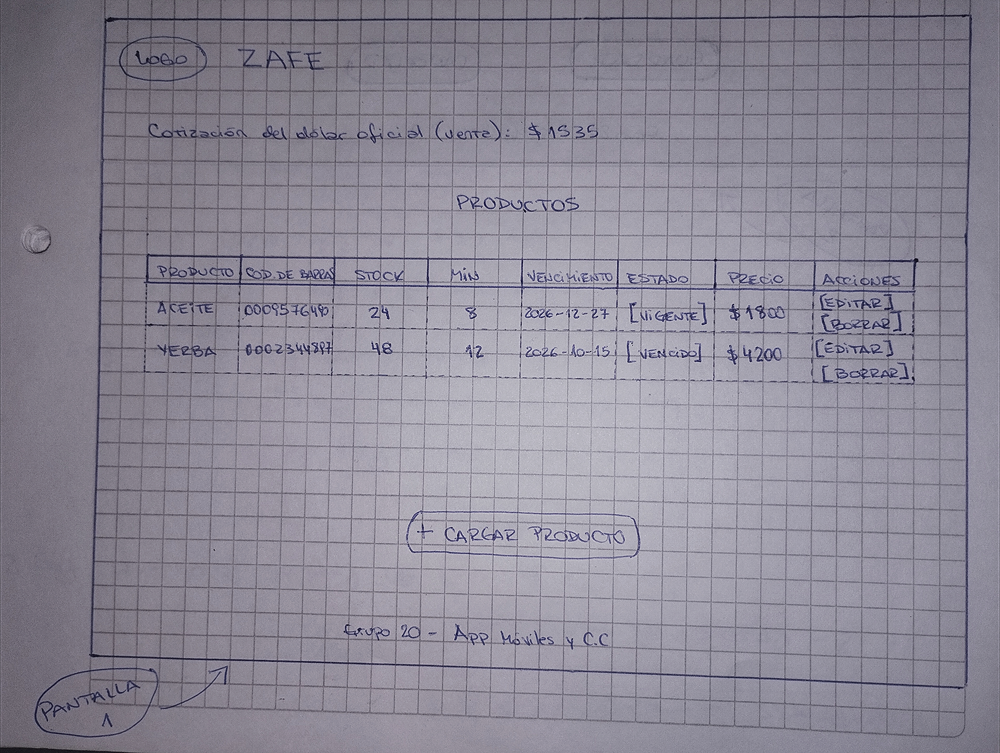

**Wireframe 2**

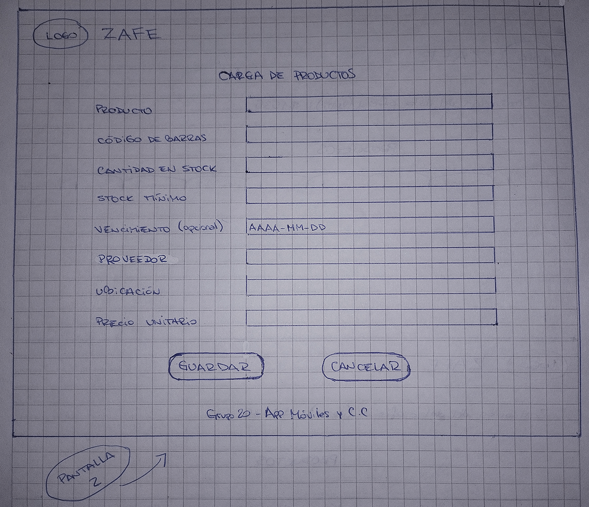

## 2. Cómo correrla en local con XAMPP
1. Descomprimir el .zip en `C:\xampp\htdocs\zafe`
2. Iniciar Apache y MySQL en XAMPP

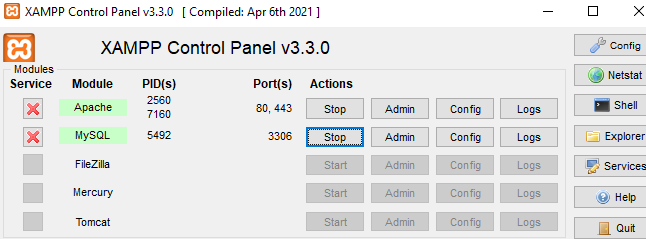

3. Crear base `gestor_stock` en phpMyAdmin e importar `sql/script.sql`

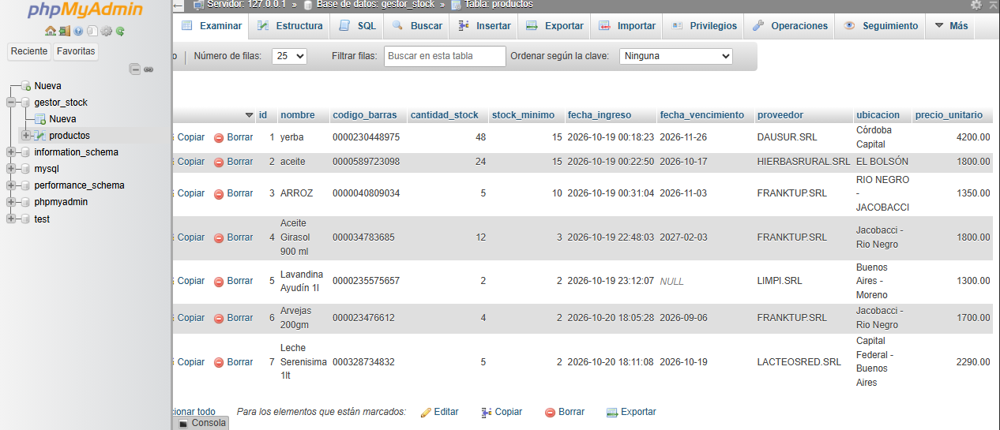

4. Abrir `http://localhost/zafe/index.html`

En local `api/config.php` lee con `getenv()` y los mails quedan en simulación en `api/avisos.log`.

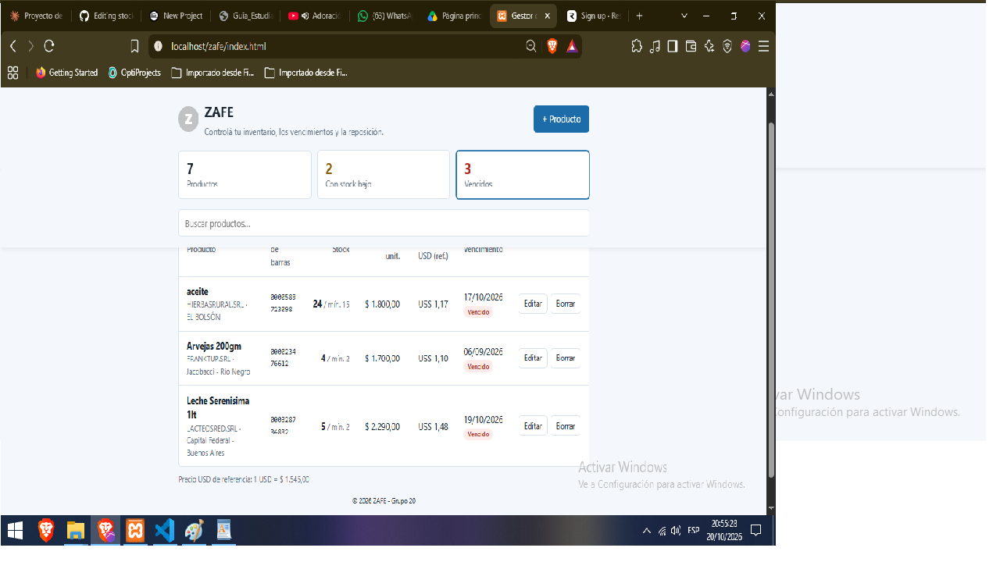

## 3. Endpoints de la API
| Método | Ruta | Qué recibe | Qué devuelve | Códigos |
|---|---|---|---|---|
| GET | /api/productos.php | - | lista productos | 200, 500 |
| GET | /api/productos.php?id=1 | id | un producto | 200, 404, 500 |
| POST | /api/productos.php | JSON nombre, codigo_barras, cantidad_stock, stock_minimo, fecha_vencimiento?, proveedor, ubicacion, precio_unitario | producto creado | 201, 400, 500 |
| PUT | /api/productos.php?id=1 | JSON | actualizado | 200, 400, 404, 500 |
| DELETE | /api/productos.php?id=1 | - | ok | 200, 404, 500 |
| GET | /api/cotizacion.php | - | {"cotizacion": 1540.0} | 200, 500 |

## 4. Variables de entorno
Se leen con `getenv()` en `api/config.php`. Sin valores reales en el .zip.

| Variable | Para qué sirve |
|---|---|
| DB_HOST, DB_PORT, DB_NAME, DB_USER, DB_PASS | Conexión MySQL |
| RESEND_API_KEY | Clave Resend mails |
| EMAIL_AVISOS | Mail donde llegan avisos stock bajo |
| ENTORNO | desarrollo / produccion |

## 5. Servicios externos
- **Resend:** Lo llama el backend porque la clave no puede ir al navegador. Salen email y datos del producto. Si falla, queda en log.
- **DolarApi:** Lo llama el backend para evitar CORS/Mixed Content. No salen datos personales. Si falla, muestra "Cotización no disponible" y la app sigue.

## 6. Despliegue
- **Proveedor:** Railway (PaaS)
- **Por qué PaaS:** Nos da Dockerfile igual a XAMPP, MySQL aparte, variables de entorno y HTTPS. Hosting gratuito bloquea app Android del TP N°2.
- **Base en la nube:** MySQL de Railway con `sql/script.sql` importado.

**Pasos para redeplegar sin GitHub:** `railway up` desde la carpeta local, o New Project > Deploy from GitHub si usan repo privado.

## 7. Limitaciones conocidas
- Mails solo por stock bajo, no por vencimiento.
- Sin login ni historial.
- Resend de prueba solo llega al titular.
- Avisa cada vez que queda bajo, aunque ya estaba bajo.
- Primera visita en Railway tarda 30s (se duerme).

## 8. Aportes - Obligatorio al entregar sin GitHub
| Integrante | Qué hizo | Fechas |
|---|---|---|
|---|---|---|
| [Mesarra Ariel]  | Backend, API productos, validaciones, SQL | 15-18/10 |
| [Del Fresno Luca] | Frontend, tabla, tarjetas, CSS | 16-19/10 |
| [Cabrera Giuliana] | Servicios externos, cotización, mails | 17-19/10 |
| [Velazquez Yanina] | Bocetos, README, despliegue, pruebas | 18-20/10 |

### 9. Sistema de avisos por email (Resend + DolarApi)

#### Ejemplo 1: Aviso de Stock Bajo

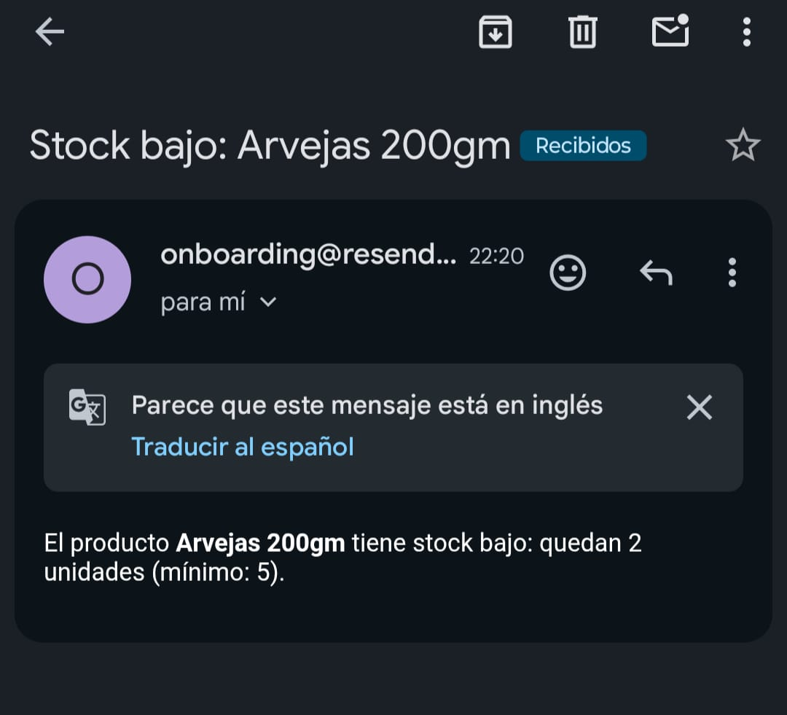

> Detecta cuando `cantidad_stock < stock_minimo`. En este caso el producto Arvejas 200gm tiene 2 unidades y el mínimo es 5, por eso envía el mail automático.

#### Ejemplo 2: Aviso de Producto Vencido

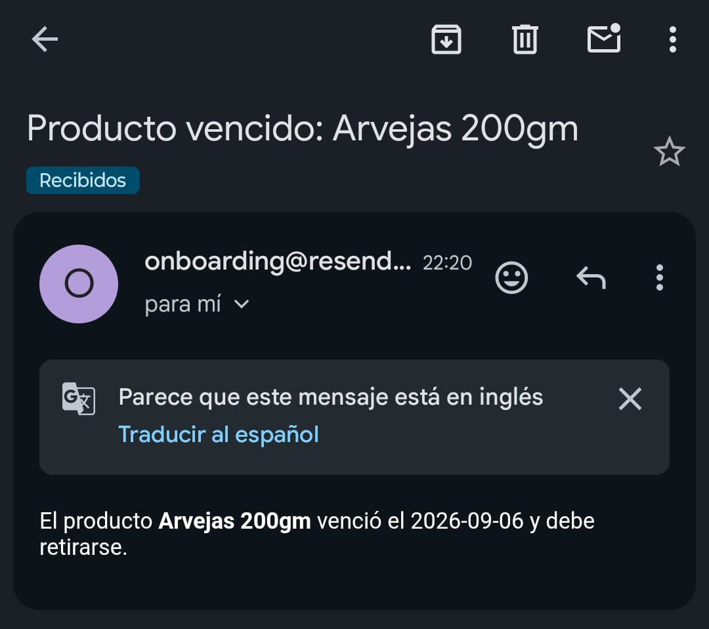

> Detecta cuando `fecha_vencimiento < hoy`. El producto Arvejas 200gm venció el 2026-09-06 y el sistema avisa para retirarlo.

#### Prueba general

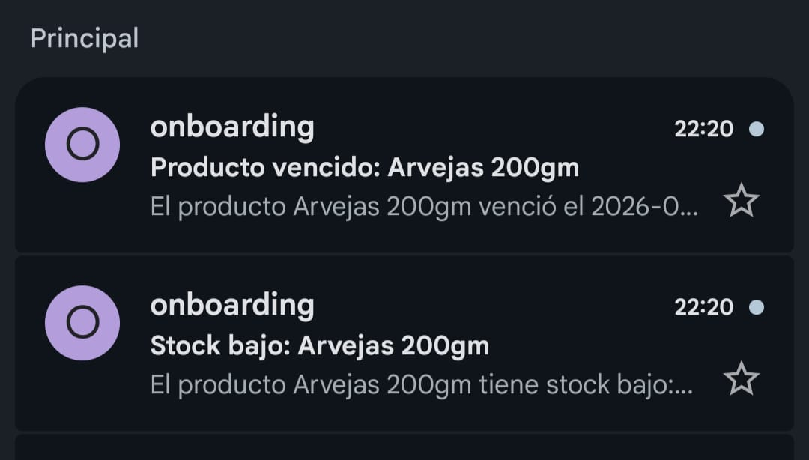

> Ambos avisos funcionando en tiempo real. Implementado en `servicios.php` con timeout de 5s y modo simulación si no hay API KEY.

#### 10. Capturas del sistema

#### 1. Dashboard - Productos vencidos
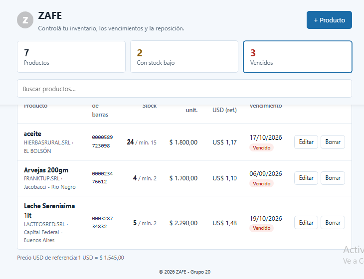
Panel superior con métricas. Muestra productos totales, stock bajo y vencidos.

#### 2. Alerta de stock bajo
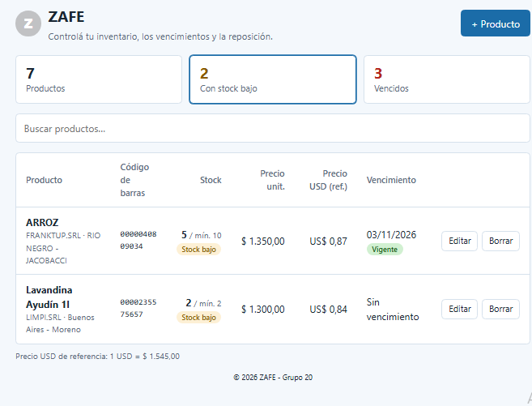
Productos por debajo del stock mínimo marcados en naranja (5 / mín. 10).

#### 3. Control de vencimientos
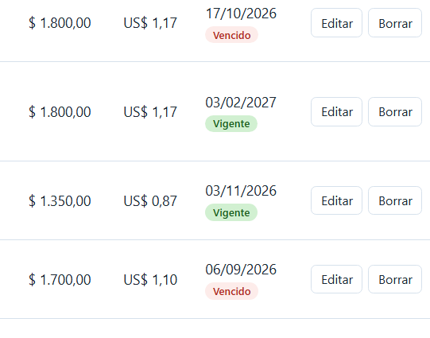
Estados Vigente en verde y Vencido en rojo según fecha.

#### 4. Productos sin vencimiento
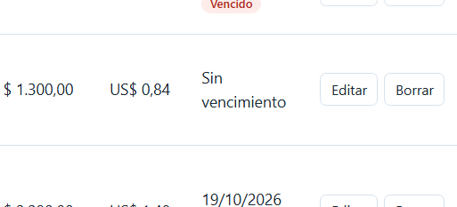
Artículos no perecederos sin fecha de vencimiento configurada.

#### 5. Crear producto
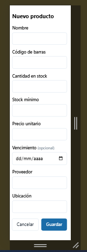

Formulario para cargar un producto nuevo con código, stock, precios y vencimiento.

#### 6. Editar producto
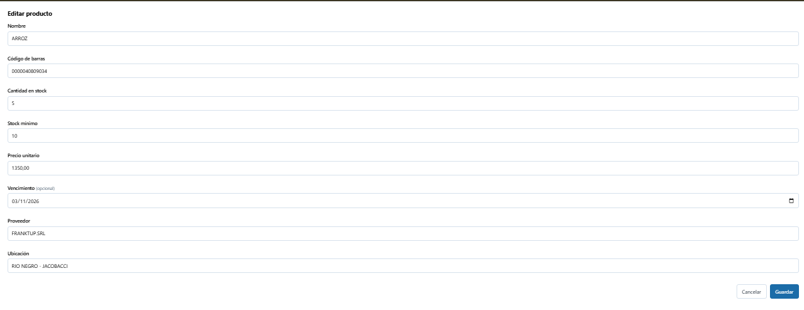
Modificación de un producto ya cargado.

#### 7. Buscador en tiempo real
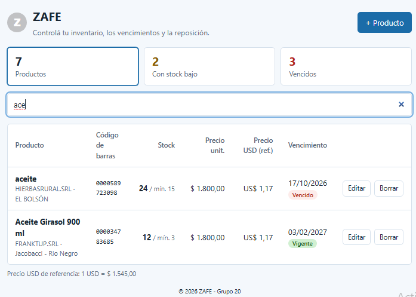
Filtra instantáneamente al escribir. Ej: "ace" muestra solo aceites.

#### 8. Cotización en dólares
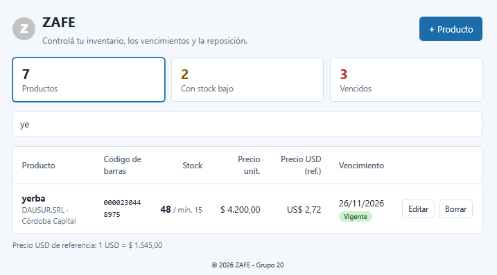
Cálculo automático: Precio ARS / Dólar oficial. Ej: $1800 / $1545 = US$ 1,17. Referencia para mantener rentabilidad.
